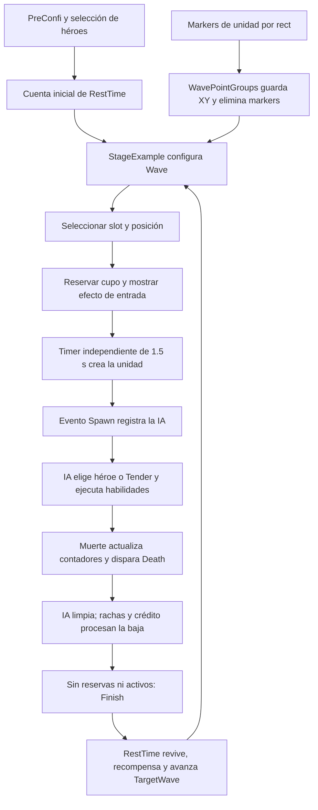

# Evaluación de WaveSys — 23 de octubre de 2026

> **Versión inicial histórica.** La [evaluación ampliada vigente](evaluacion-completa-wavesys-2026-10-23.md) incorpora recursos de DevMission, E13–E15 y los ensayos posteriores. Las limitaciones pendientes que figuran debajo describen este primer corte.

> Informe de la revisión original congelada en `evidence/original-manifest.json`. Después, por solicitud del usuario, se creó [WavePlayerUtils](wave-player-utils.md) en la copia de trabajo y se migraron 16 consumidores. Las referencias siguientes a fuentes intactas y a 113 entradas describen la revisión auditada; el original de WarDatsPy sigue intacto. E04 permanece abierto para la interfaz antigua, con aislamiento verificado del registro de partida.

**Dictamen:** el sistema tiene una base útil para supervivencia y una separación reconocible entre generación, IA y habilidades. La recogida de puntos por marcadores funciona en el ensayo final. No lo considero todavía una base fiable para ampliar sin corregir primero el ciclo de vida, los eventos y la gestión de jugadores. Encontré **12 hallazgos concretos**: un bloqueo de compilación, seis comportamientos del núcleo reproducidos en Classic —uno de ellos exige decidir el alcance de «pausa»— y cinco defectos adicionales contrastados por sus rutas en fuente. Los siete FAIL de la prueba del núcleo corresponden a seis hallazgos; no son siete defectos independientes.

La evaluación no aplica correcciones a tu sistema. `src/` conserva las 162 fuentes y artefactos JASS/PowerShell byte a byte. Los cambios de diagnóstico están exclusivamente en entradas generadas de `artifacts/`. La copia original de WarDatsPy tampoco recibió cambios de código.

## Qué se revisó y qué se ejecutó

- Carpeta solicitada: `/home/snz/Documentos/WarDatsPy/struct/`; no se mezcló `struct-rebuild`.
- Copia independiente: `/home/snz/Documentos/ChatGPT/Proyect/WaveSys/`.
- Builder real: `src/build/build-jass.ps1`, 113 archivos `.j` activos; las carpetas Pruebas, build, MissileExamples y logs no pertenecen a esa unidad por defecto.
- El subsistema `WaveSysAnAI` contiene 34 archivos, unas 11.280 líneas. Se siguieron las rutas centrales de Wave, puntos, IA, habilidades y consumidores; la revisión no equivale a una auditoría completa línea por línea de todas las bibliotecas de terceros ni de todas las armas del proyecto.
- Construcción completa: entrada nueva con las 113 fuentes, 15 rects del mapa declarados como null y config/main mínimos. La fuente exacta fue rechazada por JassHelper. Una variante que sólo renombra cuatro identificadores InitTrig pasó JassHelper y pJASS. Los rects null sólo permiten comprobación de tipos/sintaxis, no una partida de producción.
- Laboratorio nativo: cinco bibliotecas exactas —Table, TimerUtils, SwlsMath, WaveTest y WavePointGroups—, declaración Classic UnitAlive y borde TheEnd.endF vacío. Todas las waves usan callback final vacío. Esto permite estudiar el núcleo sin cargar selección, tienda, objetos ni habilidades ajenas al caso.
- Se compiló, empaquetó y reextrajo cada mapa del laboratorio. El JASS reextraído coincide por hash; se conservaron los demás miembros y la cabecera de la copia base TerrainDev.
- Dos ejecuciones finales comparables del fixture en Warcraft III Classic 1.27b, un cliente SP: baseline exacta **18 comprobaciones, 7 FAIL**; diagnóstico con la única inicialización de slot **18 comprobaciones, 5 FAIL**. El diagnóstico confirma una causa; no aprueba los cinco comportamientos restantes.
- Un tercer ensayo final, `removal-delayed`, esperó0.5s tras RemoveUnit: el motor ya devolvía tipo0, pero la Wave conservaba activo1 y no finalizaba, ni siquiera con terminate(true). Esto descarta que el contador obsoleto fuese sólo el retraso nativo de eliminación.
- Una ejecución preliminar se conserva como desarrollo. Sus dos fallos de preparación de marcadores se corrigieron: CreateUnit había desplazado coordenadas coincidentes y GetUnitTypeId aún no reflejaba la eliminación en el mismo hilo. No se atribuyen al producto.
- Lint: 34 fuentes examinadas en una copia UTF-8, 35 avisos WARNING y ningún ERROR de sus reglas. El primer intento abortó por CP1252. Este lint no detectó varios defectos demostrados y no certifica el sistema.
- Las cuatro partidas propias se cerraron tras guardar registros y capturas. No se hizo LAN ni se probó el mapa de supervivencia original, que no venía dentro de la carpeta.

**Estado más fuerte acreditado:** `Tested in map`, con fallos y únicamente para el núcleo del laboratorio. El conjunto original permanece con compilación fallida en este toolchain; el resto se evaluó estáticamente y con la variante de compilación descrita.

## Cómo está conectado realmente

`WaveTest` es el nombre de biblioteca; `Wave` es la instancia del generador. `WaveSlot` define tipo, propietario, cantidad, límite, prioridad, killGate y metadatos de IA. `PendingSpawn` conserva una reserva, el token de generación, el slot y las coordenadas durante el efecto. IAManager escucha Spawn, External, Death, Pause, Resume, Start y Finish. Las habilidades enemigas comparten el mismo Wave/TimerUtils/Table/Missile y sus propios estados y temporizadores.

Los refuerzos reales del boss están en IAManager (`AIBossReinforcementApplySlots`); `WaveReinforcements.j` contiene una biblioteca vacía. Los refuerzos amplían slots de la misma instancia, no crean otra Wave. Esto preserva los límites existentes y explica por qué el total de enemigos puede aumentar durante la oleada.

## Lo que sí conviene conservar

1. **Marcadores desacoplados del generador.** El grupo se construye una vez y luego se aplica a cada instancia sin volver a buscar unidades. En el ensayo se recogieron los markers, se eliminaron, se deduplicó una posición forzada y se respetó el orden Y descendente.
2. **Reservar antes de crear.** Los cupos por slot y propietario incluyen el tiempo de preparación. Evita excederlos sólo porque todavía se ve el efecto de entrada. Es una decisión acertada; la interfaz debería distinguir reserva de unidad materializada.
3. **Tokens para cancelar reservas.** La terminación normal invalida los callbacks anteriores y espera su devolución. Es preferible a destruir los slots mientras sus timers todavía los usan. La API pública de destrucción necesita restricciones adicionales, señaladas abajo.
4. **Separación de cantidades y bajas.** Existen getters semánticos para objetivos pendientes y bajas reales. Los nombres heredados totalKilled son confusos, pero la documentación ya reconoce que significan «por matar»; no los traté como una cuenta acumulada mal calculada.
5. **IA con presupuesto y héroes registrados.** Evita buscar todos los héroes en grupos grandes por cada enemigo. Tiene enfriamientos, backoff de órdenes fallidas y bloqueo de canalización. Hay ajustes pendientes; la estructura permite corregirlos sin rehacer todo el sistema.
6. **Limpieza normal presente.** La muerte de una unidad de slot sí libera sus contadores en el laboratorio. También se liberan multiboarditems y muchos efectos y timers. Los defectos encontrados son rutas y contratos concretos, no ausencia general de limpieza.

## Hallazgos priorizados

P1: corregir antes de usar como base fiable o de depender de esa función. P2: corregir antes de ampliar la función afectada. «Motor» indica reproducción real; «estático» no afirma que se haya observado el síntoma en tu mapa histórico.

| ID | Prioridad | Hallazgo | Evidencia |
|---|---|---|---|
| [E01](/home/snz/Documentos/ChatGPT/Proyect/informes/errores/2026-10-23-015734-wavesys-e01-inittrig.md) | P1 | La unidad de fuentes actual no compila sin adaptación | Compilador |
| [E02](/home/snz/Documentos/ChatGPT/Proyect/informes/errores/2026-10-23-015734-wavesys-e02-muerte-invocado.md) | P1 | La muerte de invocados aborta antes de avisar y limpiar | Motor |
| [E03](/home/snz/Documentos/ChatGPT/Proyect/informes/errores/2026-10-23-015734-wavesys-e03-removeunit.md) | P1 | RemoveUnit deja la oleada esperando unidades inexistentes | Motor |
| [E04](/home/snz/Documentos/ChatGPT/Proyect/informes/errores/2026-10-23-015734-wavesys-e04-jugadores-salida.md) | P1 | PlayerUtils corrompe el índice compacto de jugadores al salir | Estática |
| [E05](/home/snz/Documentos/ChatGPT/Proyect/informes/errores/2026-10-23-015734-wavesys-e05-ids-habilidades.md) | P1 | Las habilidades agotan índices acumulativos sin reciclar | Estática |
| [E06](/home/snz/Documentos/ChatGPT/Proyect/informes/errores/2026-10-23-015734-wavesys-e06-contexto-eventos.md) | P2 | Los eventos anidados borran el contexto del evento exterior | Motor |
| [E07](/home/snz/Documentos/ChatGPT/Proyect/informes/errores/2026-10-23-015734-wavesys-e07-table-handles.md) | P2 | La limpieza de Table usa el tipo equivocado | Motor |
| [E08](/home/snz/Documentos/ChatGPT/Proyect/informes/errores/2026-10-23-015734-wavesys-e08-conteo-puntos.md) | P2 | Aplicar puntos devuelve una cantidad que no se insertó | Motor |
| [E09](/home/snz/Documentos/ChatGPT/Proyect/informes/errores/2026-10-23-015734-wavesys-e09-pausa-reservas.md) | P2 | La pausa permite materializar apariciones ya reservadas | Motor |
| [E10](/home/snz/Documentos/ChatGPT/Proyect/informes/errores/2026-10-23-015734-wavesys-e10-cache-ordenes.md) | P2 | La memoria de órdenes puede impedir reanudar persecución | Estática |
| [E11](/home/snz/Documentos/ChatGPT/Proyect/informes/errores/2026-10-23-015734-wavesys-e11-tablero-descanso.md) | P2 | El tablero inicial sobrescribe la interfaz de descanso y victoria | Estática |
| [E12](/home/snz/Documentos/ChatGPT/Proyect/informes/errores/2026-10-23-015734-wavesys-e12-aura-compactacion.md) | P2 | El aura pierde miembros vivos al retirar una entrada inválida | Estática |

### E01 · La unidad de fuentes actual no compila sin adaptación

Fuente: [src/Environment/Config/VisionConfig.j:55](/home/snz/Documentos/ChatGPT/Proyect/WaveSys/src/Environment/Config/VisionConfig.j:55).

JassHelper prohíbe InitTrig_Event dentro de library VisionConfi. También hay InitTrig_Vars, InitTrig_gg e InitTrig_ShowMenuClient dentro de bibliotecas.

**Contraste:** Harness de 113 fuentes actuales: compilación original rechazada; variante generada que renombra cuatro identificadores compila y valida con pJASS.

**Impacto:** Impide reconstruir la carpeta actual con el JassHelper Classic instalado. No prueba que el mapa histórico exportado tuviera el mismo fallo.

**Alcance:** Compilador; original intacto, sólo variante de diagnóstico válida.

### E02 · La muerte de invocados aborta antes de avisar y limpiar

Fuente: [src/WaveSysAnAI/SwlsWave/SwlsWave.j:1919](/home/snz/Documentos/ChatGPT/Proyect/WaveSys/src/WaveSysAnAI/SwlsWave/SwlsWave.j:1919).

La variable local WaveSlot s queda sin inicializar en la rama ExternalIsBoss y se lee al pasarla a WaveFireDeath en la línea 2015.

**Contraste:** core-baseline2: listener externo=0 y asociación WaveByUnit presente tras la muerte. Mismo fixture con sólo s=0 en JASS generado: listener=1 y asociación ausente.

**Impacto:** Se pierden avisos de IA/rachas/limpieza de habilidades; queda una asociación obsoleta para la unidad externa.

**Alcance:** Reproducido en 1.27b y causa contrastada con un cambio aislado. El registro automático de invocados no está conectado en las fuentes activas.

### E03 · RemoveUnit deja la oleada esperando unidades inexistentes

Fuente: [src/WaveSysAnAI/SwlsWave/SwlsWave.j:1914](/home/snz/Documentos/ChatGPT/Proyect/WaveSys/src/WaveSysAnAI/SwlsWave/SwlsWave.j:1914).

Sólo EVENT_PLAYER_UNIT_DEATH descuenta las unidades; no hay reconciliación de GetUnitTypeId=0 ni conexión con DEINDEX.

**Contraste:** Ensayo diferido removal-delayed: setup=1 y engineRemoved=1 tras esperar0.5s; active=1, tracked=1, finished=0 y forceTerminated=0, con ticks naturales y una comprobación explícita de fin.

**Impacto:** La condición de fin en onTick exige activeOnMap<=0: retirar entidades sin matarlas puede bloquear el fin de oleada y terminate.

**Alcance:** Reproducido en 1.27b después de la eliminación real del motor; tampoco finalizó mediante terminate(true). No implica que el flujo normal actual retire enemigos con RemoveUnit.

### E04 · PlayerUtils corrompe el índice compacto de jugadores al salir

Fuente: [src/libraries/PlayerUtils.j:187](/home/snz/Documentos/ChatGPT/Proyect/WaveSys/src/libraries/PlayerUtils.j:187).

Se asigna PlayingPlayerIndex[i]=PlayingPlayerIndex[AmountPlaying], aunque i es una posición compacta y la clave del inverso debe ser el id del jugador movido.

**Contraste:** Con usuarios 0,1,2,3: sale 1, el jugador 3 queda en posición1 pero su inverso sigue en3. Al salir3, se modifica posición3 fuera del rango activo, quedando 3 en el recorrido y desapareciendo2.

**Impacto:** Los 17 consumidores de fromPlaying pueden dar premios, resucitar o recorrer usuarios equivocados.

**Alcance:** Defecto lógico estático y escenario trazado; no se ejecutó un ensayo de desconexiones con varios clientes.

### E05 · Las habilidades agotan índices acumulativos sin reciclar

Fuente: [src/WaveSysAnAI/WaveProjectiles/WaveRangedSkills.j:386](/home/snz/Documentos/ChatGPT/Proyect/WaveSys/src/WaveSysAnAI/WaveProjectiles/WaveRangedSkills.j:386).

CastCount crece y no se devuelve; BossLightningIndex=castId*bj_MAX_PLAYER_SLOTS+playerId. La API Classic local fija bj_MAX_PLAYER_SLOTS=16.

**Contraste:** castId512 produce índices8192..8207, fuera de un array Classic. El contador se comparte entre casts normales y boss. Otros siete módulos usan contadores acumulativos similares.

**Impacto:** Las sesiones largas y refuerzos repetidos pueden alcanzar accesos inválidos aun con pocas habilidades simultáneas.

**Alcance:** Desbordamiento demostrado por expresión y límites de arrays; no se reprodujeron 512 casts en motor ni se atribuye un crash concreto.

### E06 · Los eventos anidados borran el contexto del evento exterior

Fuente: [src/WaveSysAnAI/SwlsWave/SwlsWave.j:186](/home/snz/Documentos/ChatGPT/Proyect/WaveSys/src/WaveSysAnAI/SwlsWave/SwlsWave.j:186).

Push escribe globals y Clear los pone a cero; no hay pila/restauración al despachar otro evento.

**Contraste:** En core-baseline2 un listener Start llama pause; el siguiente listener Start recibe Wave=0.

**Impacto:** Un consumidor posterior puede recibir instancia, unidad, killer o slot incorrectos bajo reentrada.

**Alcance:** Reproducido en 1.27b con Start→Pause; no implica que todos los listeners existentes disparen eventos anidados.

### E07 · La limpieza de Table usa el tipo equivocado

Fuente: [src/WaveSysAnAI/SwlsWave/SwlsWave.j:1081](/home/snz/Documentos/ChatGPT/Proyect/WaveSys/src/WaveSysAnAI/SwlsWave/SwlsWave.j:1081).

Table.remove llama RemoveSavedInteger, pero WaveActiveUnitByKey se escribió con SaveUnitHandle. El contrato correcto para handles está en Table.handle.remove.

**Contraste:** core-baseline2: tras muerte normal el contador baja a0, pero WaveActiveUnitByKey.handle.has(key) sigue true. Patrón estático repetido en IA, aura y priest; IA además borra reales como enteros.

**Impacto:** Retención de referencias y datos que deberían haberse liberado. Tamaño, crecimiento y efecto sobre memoria/FPS no medidos.

**Alcance:** Reproducido en el núcleo; los restantes sitios se contrastaron por el tipo real de Table. No es por sí solo prueba de fuga ilimitada.

### E08 · Aplicar puntos devuelve una cantidad que no se insertó

Fuente: [src/WaveSysAnAI/SwlsWave/WavePointGroups.j:309](/home/snz/Documentos/ChatGPT/Proyect/WaveSys/src/WaveSysAnAI/SwlsWave/WavePointGroups.j:309).

Se retorna count del grupo aunque Wave.addPoint rechace inserciones por su límite100; el grupo admite128.

**Contraste:** core-baseline2: Wave ya tiene99 puntos, grupo2; retorno2 y sólo1 punto añadido.

**Impacto:** StageExample compara el retorno con el tamaño del grupo y no detecta truncación.

**Alcance:** Reproducido en motor. La recogida, deduplicación y ordenación del grupo sí pasaron en el fixture final.

### E09 · La pausa permite materializar apariciones ya reservadas

Fuente: [src/WaveSysAnAI/SwlsWave/SwlsWave.j:1379](/home/snz/Documentos/ChatGPT/Proyect/WaveSys/src/WaveSysAnAI/SwlsWave/SwlsWave.j:1379).

pause detiene sólo loopTimer. PendingSpawn_execute tiene timer propio y no consulta isPaused.

**Contraste:** core-baseline2 reserva una aparición, pausa antes de que se materialice y observa paused=1 y tracked=1 al cumplirse1.5s.

**Impacto:** La pausa es parcial: deja avanzar el materializado y no congela ataques nativos ni timers de habilidades.

**Alcance:** Comportamiento reproducido; si la API pretende sólo suspender nuevas reservas, debe documentarlo. No se modifica la semántica sin decisión de diseño.

### E10 · La memoria de órdenes puede impedir reanudar persecución

Fuente: [src/WaveSysAnAI/AI/IAManager.j:1259](/home/snz/Documentos/ChatGPT/Proyect/WaveSys/src/WaveSysAnAI/AI/IAManager.j:1259).

Se omite attack al mismo target por el valor cacheado; habilidades custom emiten stop y no invalidan ese caché.

**Contraste:** WaveBarrierStart:229, WaveRangedStartHrifCast:408 y WaveMortarSkillsTryExecute:364 emiten stop; las ramas custom de AIEvaluateUnit retornan sin AIResetOrderState.

**Impacto:** Tras una habilidad, un objetivo que sigue siendo el mismo puede no recibir una nueva orden de persecución. La auto adquisición nativa puede ocultarlo a corta distancia.

**Alcance:** Ruta estática contrastada; no se reprodujo este caso con las habilidades y objetos reales en el motor.

### E11 · El tablero inicial sobrescribe la interfaz de descanso y victoria

Fuente: [src/Multiboard/InitialWaveMultiboard.j:67](/home/snz/Documentos/ChatGPT/Proyect/WaveSys/src/Multiboard/InitialWaveMultiboard.j:67).

Su timer de0.10s sólo discrimina isWavez; RestTime pone isWavez=false, y Populate restablece título Preparando, layout6x5 y estado Selección.

**Contraste:** RestTimeOnWaveFinished:29 pone false; Countdown escribe tienda/cuenta atrás una vez por segundo; Tick inicial vuelve a escribir hasta diez veces por segundo.

**Impacto:** Se pisan los títulos de descanso y victoria y se pierde la presentación de la cuenta atrás en el tablero.

**Alcance:** Conflicto de escritores demostrado en fuente; no se probó el flujo completo del mapa original.

### E12 · El aura pierde miembros vivos al retirar una entrada inválida

Fuente: [src/WaveSysAnAI/WaveProjectiles/WaveAuraSkills.j:454](/home/snz/Documentos/ChatGPT/Proyect/WaveSys/src/WaveSysAnAI/WaveProjectiles/WaveAuraSkills.j:454).

La rama null/type0 decrementa MemberCount sin mover la última entrada ni limpiar el resto de mapas de membresía.

**Contraste:** Miembros1=A,2=retirado,3=C: al barrer3 y luego2, count pasa de3 a2, pero C sigue en3 y queda fuera del recorrido posterior.

**Impacto:** Puede quedar un buff/propietario de aura sin retirar al terminar; es independiente del borrado Table con tipo erróneo.

**Alcance:** Defecto lógico estático; sin ensayo con el objeto rspl y los buffs del mapa original.

## Puntos de reaparición, efectos y cercanía al jugador

La interpretación correcta de «captura» es recoger posiciones de unidades marcadoras, no conquistar zonas. El grupo Stage1_ThePueblo usa el rect `gg_rct_ZoneThePueblo` y el rawcode `l00A`. No puedo acreditar que ese objeto ni esos markers existan en el mapa original sin su archivo de objetos y unidades. El comentario «placeholder» tampoco prueba que el rawcode sea incorrecto.

El collector acepta hasta128 posiciones, ordena por Y/X, deduplica con tolerancia0.1 y elimina todo marker que reconoce. Por tanto:

- El exceso de capacidad elimina también el marker cuyo punto no llegó a guardarse. Esto se debe diagnosticar antes de destruirlo o dejar un registro del descarte.
- Los grupos con rects superpuestos y el mismo tipo de marker compiten por unidades: el primero consume el marker, el siguiente ya no lo ve. Conviene prohibir solapes o recoger una vez y distribuir después.
- `WavePointGroupsBuild` borra las posiciones previas antes de releer. Llamarlo otra vez cuando los markers ya fueron eliminados deja grupos vacíos. El encabezado avisa que se construye una vez; debe tratarse como una restricción de API, no como una carga idempotente.
- Los nombres se identifican sólo por `abs(StringHash(name))`, sin comparar el string. Una colisión puede mezclar grupos; el valor absoluto también combina hashes opuestos. No demostré una colisión para los nombres actuales.

En StageExample, `Wave.create(30,15,0.25,...)` fija15% de intentos cerca de héroes y85% en puntos base. Si falla la cercanía se usan markers. Si faltan todos los markers, se escribe Error No Points pero la oleada sigue; sólo los intentos del15% que encuentren un héroe vivo y terreno válido podrán materializar reservas. Si además no queda un héroe válido, las cantidades pendientes no avanzan. No existe un diagnóstico de «sin progreso durante X segundos».

La posición cercana se muestrea a64..256 unidades, con hasta10 intentos y comprobación de pathing de terreno. No comprueba distancia respecto de todos los héroes, campo de visión, separación respecto de otros spawns ni conectividad de ruta. Un suelo caminable puede estar aislado o abarrotado. El radio tan próximo puede generar presión inmediata; decidirlo requiere una prueba de jugabilidad con velocidades, ataques y colisiones reales del mapa.

Las coordenadas se fijan al reservar, antes de los1.5s del efecto. La unidad se crea en esa posición aunque el héroe se haya desplazado o muerto durante el aviso. Para un telegraph fijo esto es coherente; si se pretende «aparecer junto al jugador en el instante final», falta otro contrato. Reposicionarlo silenciosamente al final también rompería la correspondencia con el efecto, por lo que no recomiendo hacerlo sin una decisión de diseño.

La lista nearUnits se toma al configurar la oleada. Se comprueba vida y existencia, pero no si su propietario sigue jugando. El abandono de un usuario no limpia esa lista ni AITrackedHeroByPlayer. «Héroe vivo» y «jugador activo» no son equivalentes. Tampoco hay selección equitativa garantizada: son sorteos por intento.

## Configuración y límites que pueden inmovilizar una oleada

`killGate` se compara con todos los enemigos pendientes, incluidos los del propio slot. El laboratorio muestra un caso mínimo: dos enemigos con gate1, ninguno activo, `pickSlot=0`. Nunca se puede llegar al umbral matando enemigos que aún no pueden aparecer. Las configuraciones de boss de StageExample inspeccionadas tienen umbrales mayores que sus dos bosses; ese caso mínimo no demuestra que esas oleadas estén bloqueadas. Sí demuestra que la API necesita validar la viabilidad de la configuración.

Una prioridad negativa se acepta al añadir el slot pero no puede ganar la selección inicializada en-1. Un rawcode no nulo que CreateUnit no puede crear se restaura indefinidamente. No hay máximo de reintentos, error público ni rechazo anticipado. La capacidad100 slots y100 puntos se resuelve con return silencioso. Todos son estados que deberían reportar «configuración no válida», en vez de mantener un timer sin progreso.

El compilado permite **80 instancias Wave simultáneas**, por los arrays internos de100. `Wave.create` no comprueba que allocate devolviera0 y continúa escribiendo la instancia0. No es un límite de ochenta oleadas sucesivas: el reciclaje permite muchas más en serie. Este riesgo aparece al superar la concurrencia, no en el stage actual de una sola instancia.

`destroyWave` y `finish` son públicos y pueden saltarse la espera de unidades y reservas. Un callback pendiente conserva ids de WaveSlot; si se destruye y recicla la instancia antes del vencimiento, ya no basta con detectar token distinto y descontar sobre el slot antiguo. Conviene cerrar esa entrada pública o exigir un método de cancelación con contrato claro. No ejecuté este caso de reutilización prematura.

`upsertSlotExByPlayers` amplía cantidades si encuentra el grupo, pero conserva los límites, prioridad, FX, perfil y flags anteriores. El nombre puede sugerir que también actualiza esa configuración. En los refuerzos actuales se pasan valores compatibles; el problema es el contrato para futuras configuraciones dinámicas.

## Dependencias y límites de integración

**La independencia de Wave termina en el coordinador de partida.** TheEnd desemboca en RestTime, que usa TargetWave, isWavez, WaveTgg, un timer y un tablero globales. Dos waves con callback final no vacío avanzarían el mismo contador y reemplazarían la misma cuenta regresiva. Dos instancias con el mismo board también comparten WaveByBoard. No es un coordinador completo de múltiples arenas independientes, aunque el generador pueda tener varias instancias. StageExample usa una sola y los refuerzos amplían esa misma, de modo que no afirmo interferencia actual entre arenas.

No hay enlace activo visible desde `EVENT_PLAYER_UNIT_SUMMON` hacia `registerExternalUnit`. Tampoco encontré consumidores activos de WaveSpawnUnitFromDefaultOwners fuera de sus envoltorios. Esas funciones de spawn crean la entidad, pero no la registran por sí solas como unidad de Wave. Si el mapa original tiene un trigger GUI de invocación fuera de esta carpeta, hay que incluirlo antes de evaluar la integración completa. E02 sí es un fallo real de la API registrada, reproducido mediante su llamada pública.

WaveTest usa UnitAlive, pero su declaración está en SpellIndex. Los requires de WaveTest no expresan esa dependencia. El harness aislado necesitó declarar la misma native Classic; la construcción completa sí la aporta indirectamente. Separar TheEnd por interfaz también haría al generador mucho más fácil de reutilizar y probar sin cargar selección, tienda y armas.

**Vidas y final de supervivencia:** HeroLives consume una vida y programa resurrección1.5s después; al llegar a0 todavía completa esa última resurrección, y la muerte siguiente queda sin revivir. Eso representa diez reapariciones, no necesariamente «diez muertes máximas»; depende de cómo se presente la cifra. El descanso restablece diez y revive/cura a los héroes activos. El último final llega al incrementar TargetWave a11 y programa victoria18s después. En las fuentes activas no aparece un coordinador de derrota por todos los héroes agotados o por muerte del Tender. Podría existir en GUI fuera de esta carpeta; aquí no está acreditado. Una evaluación del modo completo debe incluirlo.

## IA, habilidades y rendimiento

**ThreatWeight no cambia la preferencia entre blancos.** En AISelectTargetHero cada candidato se puntúa y después se multiplica por el mismo peso positivo del enemigo que busca. Multiplicar todos por1.0 o2.0 conserva su orden. No hay una amenaza por héroe que explique que un boss con peso2 prefiera otro objetivo. Es un parámetro sin efecto sobre esa elección tal como está implementado.

El sesgo por poca vida añade como máximo180 a una puntuación dominada por distancia al cuadrado. A1000 unidades, una unidad de distancia adicional cambia la distancia cuadrada en2001; el bonus máximo no compensa ni eso. Si se pretende preferir con fuerza un héroe herido, la normalización no corresponde a esa intención. No lo presento como defecto si el sesgo débil es deliberado.

El scheduler siempre intenta agotar su presupuesto, aunque sólo tenga una unidad y el presupuesto sea48. Puede evaluar varias veces al mismo enemigo en un mismo tick. Los cooldowns impiden muchos casts duplicados, pero se repiten búsquedas y consultas sin avance del reloj. Con150 enemigos y presupuesto48, una vuelta completa requiere cuatro ticks, alrededor de0.8s en combate, frente a thinkInterval configurados de0.25s. Es el compromiso actual entre reparto y latencia; esos intervalos no son una garantía por enemigo. No se midieron FPS ni CPU total.

El movimiento no valida si una orden cacheada sigue siendo la orden actual —E10—. Los teleports comprueban visibilidad del héroe elegido y terreno caminable, pero no ruta ni distancia segura respecto de los demás héroes. Son reglas que hay que definir según el diseño de supervivencia, no corregir con una cifra arbitraria.

Las habilidades tienen timers y pausas propios. La pausa de Wave sólo impide nuevas decisiones del manager, no congela los proyectiles, windups ni órdenes nativas que ya están en marcha. Además, varias habilidades llaman PauseUnit(false) al terminar sin un árbitro común de motivos de pausa. Un segundo sistema que quiera mantener pausada la misma unidad puede perder ese estado. No hubo un ensayo de solapamiento de esos efectos.

El sacerdote conserva una «escala base» cuyo getter devuelve1.0 para cualquier tipo y después la restaura. Una unidad con escala distinta en object data u otro sistema puede acabar reescalada a1.0. Falta documentar valores por tipo o centralizar los modificadores. No inspeccioné las escalas de los objetos originales, así que no afirmo que ya se vea mal un boss específico.

El tablero activo escribe91 celdas cada0.25s:364 actualizaciones por segundo y al menos1820 llamadas nativas de GetItem/Style/Width/Value/Release, sin contar getters de estadísticas ni formato de strings. El inicial reconstruye30 celdas diez veces por segundo cuando isWavez=false. Se puede fijar layout/estilo una vez y refrescar valores sólo cuando cambian o a menor frecuencia. Son conteos derivados del código, no una medición de lag.

Los handles de timers persistentes de servicios no son automáticamente fugas: un AITimer o grupo temporal de vida de mapa puede ser intencionado. Del mismo modo, los DestroyEffect inmediatos en FX de entrada son el patrón de reproducir su animación de muerte; no se declararon defectuosos sólo por ser inmediatos.

## Escalado actual de StageExample

Las llamadas ByPlayers crean **cinco slots**, uno por propietario8..12; no crean un único grupo repartido. `perPlayerLimit=30` limita cada propietario enemigo, de modo que el techo agregado es150 reservas/unidades por Wave. No es treinta enemigos por héroe humano. Los límites por slot pueden ser más estrictos: en Wave10 cada familia usa límite2 y hpea tiene cantidad1; sin nuevas adiciones, el máximo simultáneo de ese stage es97. Con reposición suficiente de hpea por refuerzos, los slots actuales permiten hasta102, todavía por debajo del techo teórico150.

Las primeras cuatro familias usan cantidades fijas. Desde hkni en Wave5, seis familias del final sí escalan por humanos. Con P humanos, sin refuerzos:

| Oleada | 1 humano | 4 humanos | 8 humanos |
|---|---:|---:|---:|
| 1 | 5 | 5 | 5 |
| 2 | 17 | 17 | 17 |
| 3 | 27 | 27 | 27 |
| 4 | 37 | 37 | 37 |
| 5 | 47 | 77 | 117 |
| 10 | 97 | 277 | 517 |

No es necesariamente un error de balance, pero sí una transición marcada en Wave5. En Wave10 la expresión es35+60P+2 bosses. El ritmo de reserva sigue siendo uno cada0.25s para todos. Ignorando gates, cupos y bajas, materializar los97 requiere como mínimo25.75s desde el inicio; los517,130.75s. Los refuerzos del boss añaden más trabajo y pueden hacer retroceder el progreso porcentual. Medir si esto resulta divertido necesita el mapa real, armas, daño, velocidad y jugadores; los números por sí solos no lo demuestran.

## Orden recomendado de corrección y nueva validación

1. Resolver el bloqueo reproducible de compilación y declarar explícitamente las dependencias del núcleo. Mantener un build reproducible que elija la revisión real, no un AllCode histórico.
2. Corregir el slot de muertes externas y definir salida por muerte, retiro y cancelación. Verificar invariantes: activos=reservados+entidades vivas; pendientes=slots pendientes; por matar=pendientes+reservados+vivos, salvo la política explícita de cancelación.
3. Corregir PlayerUtils.onLeave y probar salidas en distinto orden con jugadores no contiguos. Contrastar tanto isPlaying como fromPlaying y destinatarios de premios/resurrecciones.
4. Reciclar ids de habilidades y visuales con límite explícito. Incluir casts normales y bosses acumulados, y probar sesiones que superen512 casts combinados y8192 emisiones/visuales mediante lotes.
5. Introducir restauración de contexto de eventos, limpieza Table por tipo, compactación correcta de aura e invalidación de órdenes al lanzar habilidades. Probar el consumidor que fallaba, no sólo el núcleo aislado.
6. Decidir la semántica de pausa y fail-fast de configuración, corregir el retorno de puntos y asignar un único escritor del tablero según fase.
7. Integrar el mapa real y completar una partida de diez oleadas con refuerzos, faltas de markers, salidas, agotamiento de vidas y final. Después realizar el ensayo multijugador pertinente. Compilar o jugar un cliente no demuestra ausencia de desincronización.

No recomiendo empezar con una reescritura completa. Los bloqueos prioritarios están localizados y la arquitectura permite arreglarlos conservando las funciones que ya sirven. Antes de optimizar, hay que asegurar que terminar, cancelar, retirar y desconectar no dejan estados que las otras piezas interpreten mal.

## Evidencias y continuidad

- [Retirada diferida en motor](../evidence/removal-delayed-engine.txt) y [captura](../evidence/removal-delayed-engine.png).
- [Baseline final en el motor](../evidence/core-engine-baseline2.txt) y [captura](../evidence/core-engine-baseline2.png).
- [Diagnóstico con slot inicializado](../evidence/core-engine-slot-init.txt) y [captura](../evidence/core-engine-slot-init.png).
- [Fixture nativo](../tests/CoreAudit.j) y [builder de laboratorio](../tools/build-core-audit.py).
- [Manifiesto de fuentes originales](../evidence/original-manifest.json), [procedencia de APIs](../evidence/api-provenance.json) y [hallazgos estructurados](../evidence/findings.json).
- [CodeGraph: consultas y límites](../evidence/codegraph-coverage.md).
- [Incidencias](../../informes/errores/2026-10-23-014024-wavesys-auditoria.md); cada E tiene su informe enlazado en la tabla.
- [Plan y continuidad](planes/evaluacion-wavesys-2026-10-23.md).

Todos los hallazgos de producto permanecen abiertos: una prueba que identifica el fallo y una variante que demuestra su causa no sustituyen una corrección autorizada de las fuentes ni su regresión integrada.
